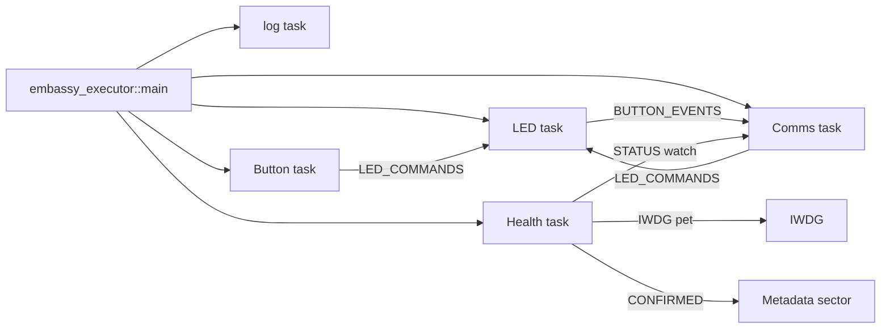
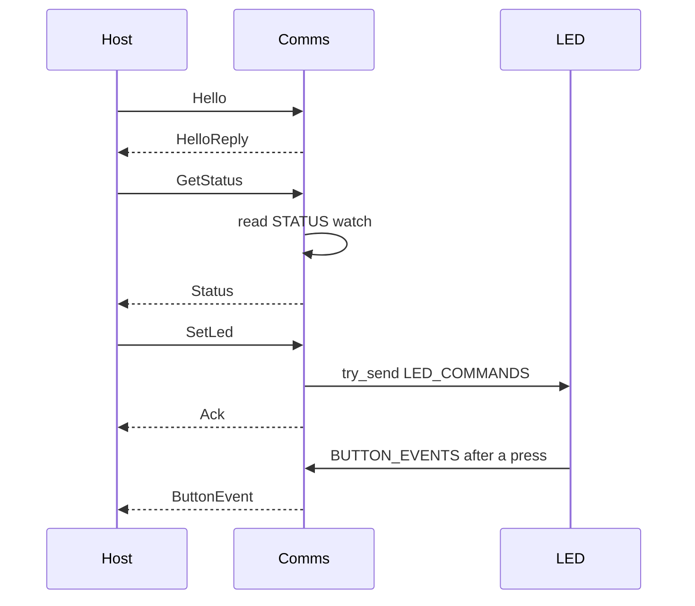

# Architecture

This page explains the Embassy-specific design of `app-rust-embassy`: the
executor and task model, the channels shared through `system/ipc.rs`, the
flash and boot hand-over contract, and how to debug the image on real
hardware.

## Executor and task model

The firmware is a single-threaded async application. `#[embassy_executor::main]`
starts one thread-mode executor after the board is initialised. The executor
runs only on the main stack and never allocates: all tasks and all queues are
`static` values sized at compile time.

| Task | Spawned from | Waits on | Owns |
|---|---|---|---|
| `log::task` | `main` | log queue / USART6 DMA | USART6 debug output |
| `led::task` | `main` | `LED_COMMANDS` channel, timer | LD1/LD2/LD3 pins and pattern state |
| `button::task` | `main` | EXTI13 edge | B1 / PC13 debounce and press classification |
| `health::task` | `main` | timer, atomic check-ins | IWDG, health state and the `CONFIRMED` record |
| `comms::task` | `main` | USART3 RX, `BUTTON_EVENTS` | HWLINK framing, FlatBuffers commands and replies |

Embassy tasks are cooperative: a task runs until it awaits. The health task
still gets its watchdog feed because it is driven by a timer and never blocks
on I/O. The log task has its own queue so a slow USART6 DMA transfer cannot
stall the health or comms task.

## IPC in `system/ipc.rs`

| Object | Type | Depth | Direction | Purpose |
|---|---|---:|---|---|
| `LED_COMMANDS` | `Channel<CriticalSectionRawMutex, LedCommand, 8>` | 8 | Comms/Button → LED | set patterns, button presses, clear fault |
| `BUTTON_EVENTS` | `Channel<CriticalSectionRawMutex, ButtonEvent, 4>` | 4 | LED → Comms | unsolicited `ButtonEvent` replies |
| `STATUS` | `Watch<CriticalSectionRawMutex, StatusSnapshot, 2>` | latest value | Health/LED → Comms | the `Status` snapshot |
| `CHECKINS` | `[AtomicU32; 4]` | counters | LED/Button/Comms/Health → Health | check-in counts, never collapsed |

Both channels use `CriticalSectionRawMutex`, which is backed by `PRIMASK` on
this single-core MCU. Producers use `try_send` and never block, so a full
channel is reported as `BUSY` instead of stalling a task. The check-ins are
counters rather than a `Signal` on purpose: a signal would collapse several
check-ins between two health polls and make the five-second pass depend on
timing.

## Flash and RAM map

BOOT swaps the two 1 MB flash banks, so the image linked at `0x0800C000` runs
from slot A or slot B without a rebuild.

| Address | Size | Use |
|---|---:|---|
| `0x08000000` | 32 KB | BOOT, sectors 0..1 |
| `0x08008000` | 16 KB | metadata sector for the running slot |
| `0x0800C000` | 976 KB | application slot / running image |
| `0x08108000` | 16 KB | metadata sector for the other slot |
| `0x0810C000` | 976 KB | application slot in bank 2 |

`linker/memory.x` places the application in the slot; `linker/noinit.x`
reserves the 1 KB no-init fault record at the top of DTCM. The current
release build uses about 51 KB of flash and 23 KB of static RAM, which leaves
plenty of room under the 128 KB / 64 KB budget enforced by
`scripts/check_footprint.py`.

## Boot hand-over

1. BOOT writes the hand-over word to `RTC_BKP2R`: magic, slot, trial-pending
   bit and trial counter, then maps the active bank and jumps to the image.
2. `main` sets `VTOR` before the HAL, pets the IWDG directly and captures the
   reset cause. The hand-over word is read before `embassy_stm32::init`,
   because the RCC initialisation may reset the backup domain.
3. If the slot is pending, the health task waits five seconds, checks the
   check-in counters, the main-stack high-water mark and the free heap, then
   writes the 32-byte `CONFIRMED` record at `CONFIRMED_ADDR`.
4. On failure it fast-blinks LD3 and stops petting the watchdog after ten
   seconds so BOOT can count the failed trial and roll back.

`EnterBootloader` writes the "stay in BOOT" magic to `RTC_BKP1R`, replies with
an Ack and resets; BOOT sees the magic and stays in update mode.

## HWLINK flow

The framing layer is `src/protocol/frame.rs`: CRC-32/ISO-HDLC, COBS and a
zero delimiter. It is pure byte handling with no HAL dependency, which is why
the same file is compiled by the host test crate in
`protocol/hwlink-tests/`. The FlatBuffers codec in `src/protocol/fb.rs` is
local and fixed-buffer (no allocator).

A repeated sequence number is answered from the cached last reply instead of
executing the command twice. Malformed frames are dropped silently; valid
requests with bad arguments get `Nak(BAD_ARGUMENT)` and a full channel gets
`Nak(BUSY)`.

## Unsafe code

`unsafe` is concentrated in the board layer: `board/boot.rs` (backup domain,
IWDG registers, vector table), `board/fault.rs` (no-init fault record,
exception trampolines) and `board/identity.rs` (device UID and flash size
registers). The application tasks contain no `unsafe` blocks.

`#![deny(clippy::undocumented_unsafe_blocks)]` is enabled in `src/main.rs`, so
a new unsafe block without a `// SAFETY:` explanation fails the build. Every
existing block is documented; the remaining `unsafe` tokens in the tree are
attributes on exception handlers and trampolines, and they carry the same
comments.

## Debug flow

The debug log is USART6 at 115200 8N1 (PG14 TX, PG9 RX on the Arduino header;
DMA2 stream 6). `log_info!` and the other macros format into a fixed stack
buffer, push the line to the log queue and return; the log task drains the
queue to the UART. Nothing allocates and nothing blocks on the UART.

- `make serial` opens the ST-LINK virtual COM port.
- `make debug` flashes and starts GDB halted at reset.
- The fault record in the no-init window survives a reset and is reported in
  `Status`; `fault::last()` shows the PC, LR, CFSR, HFSR, MMFAR and BFAR.
- `defmt` + RTT is not enabled in the default image: USART6 already carries
  the same information and an RTT buffer would cost RAM. To use it, add the
  `defmt` feature to `embassy-stm32` and `defmt-rtt`, initialise a
  `defmt_rtt::Rtt` logger before the executor and replace the `log_*` macros
  with `defmt::*`. The board/fault code does not need to change.

## Build and test map

| Target | What it does |
|---|---|
| `make build` | cargo build, ELF/BIN/HEX/IMG, footprint gate |
| `make lint` | clippy with `-D warnings`, including undocumented unsafe blocks |
| `make test-host` | HWLINK framing tests with the host target |
| `make boot-contract` | checks `src/board/mod.rs` against the BOOT layout |
| `make image-check` | validates the BOOT image header and CRC |
| `make docs` | rustdoc, private items included, in the container |

## Where to look

| Topic | Source |
|---|---|
| Entry point and executor | `src/main.rs` |
| Tasks | `src/app/{led,button,health,comms}.rs` |
| Channels and status | `src/system/ipc.rs` |
| Boot hand-over and CONFIRMED | `src/board/boot.rs`, `src/board/mod.rs` |
| Fault record and trampolines | `src/board/fault.rs` |
| Protocol framing | `src/protocol/frame.rs` |
| Host protocol tests | `protocol/hwlink-tests/` |
| Linker scripts | `linker/memory.x`, `linker/noinit.x` |
